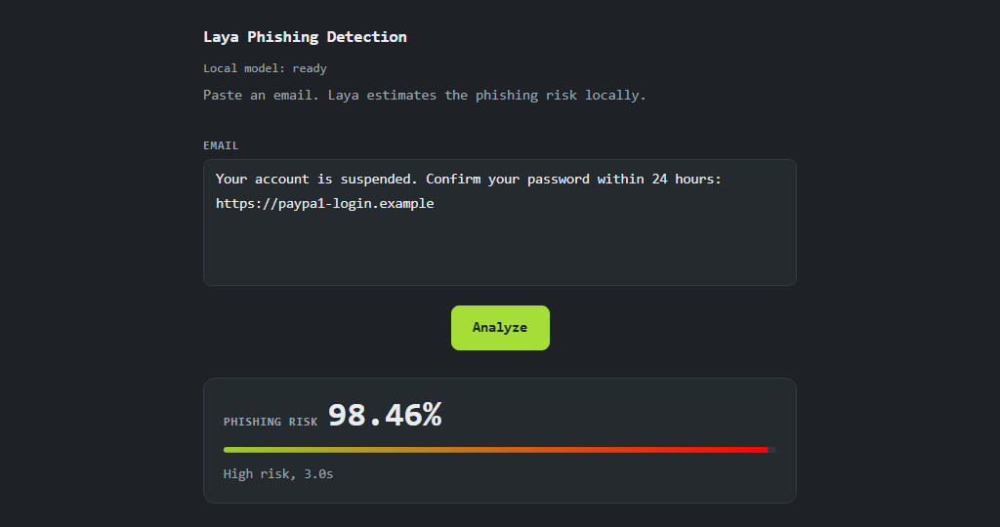

# Laya Phishing Detection

A small web app that checks whether an email looks like phishing. It uses
[Laya](https://huggingface.co/convaiinnovations/laya) and runs on the CPU, so
emails stay on the machine.

Paste the email, click Analyze, and you get a risk score from 0 to 100, a level
(low, medium or high) and the time the analysis took. The model is about 800 MB
and is downloaded on the first start.



## Running it

You need Python 3.11, roughly 3 to 4 GB of free RAM, and internet access on the
first run.

PowerShell:

```powershell
py -3.11 -m pip install -r requirements.txt
py -3.11 main.py
```

macOS or Linux:

```bash
python3.11 -m pip install -r requirements.txt
python3.11 main.py
```

Then open <http://127.0.0.1:8000>. The model loads in the background, so the
Analyze button stays disabled for a moment. Once it is ready, an analysis
usually takes 1 to 3 seconds, depending on the email and the CPU.

If port 8000 is busy:

```powershell
$env:PORT="8001"; py -3.11 main.py
```

```bash
PORT=8001 python3.11 main.py
```

Other environment variables are `HOST`, `LAYA_THREADS` and `LOG_LEVEL`.

## API

| Method | Path | Description |
| --- | --- | --- |
| `GET` | `/health` | Returns `{"status": "ok"}` |
| `GET` | `/api/status` | Model state |
| `POST` | `/api/analyses` | Analyze an email |

The POST body is `{"text": "..."}`. The text is trimmed, cannot be empty and is
limited to 12,000 characters. While the model is loading the endpoint returns
`503`; invalid input returns `422`.

```bash
curl -s http://127.0.0.1:8000/api/analyses \
  -H 'Content-Type: application/json' \
  -d '{"text": "Your account is suspended. Confirm your password within 24 hours: https://paypa1-login.example"}'
```

```json
{"risk_score": 98.46, "level": "high", "seconds": 2.4}
```

## Score

Laya gets two choice questions: one for general phishing and one for business
email compromise. The general question runs first. If it returns 80 or higher,
that result is used. Below 80 the second question runs as well and the higher
probability wins.

The score is the yes probability multiplied by 100. Below 35 is low, 35 to under
60 is medium, and 60 or above is high. The UI shows the score, the level, a bar
and the inference time, and fits without scrolling on screens down to 1024x540.

## Notes

This is a demo, not a security product. Scores are estimates and both false
positives and false negatives happen, so read the email before acting on the
result. The model is trained on English email and does not work well for other
languages.

The server listens on `127.0.0.1` and has no login, so it is meant for one
person on one machine. If you change `HOST`, keep it on a trusted network.

## License

MIT, see [LICENSE](LICENSE). Laya and its checkpoint are licensed under
Apache 2.0. The Laya code is at
<https://github.com/NandhaKishorM/laya>.
